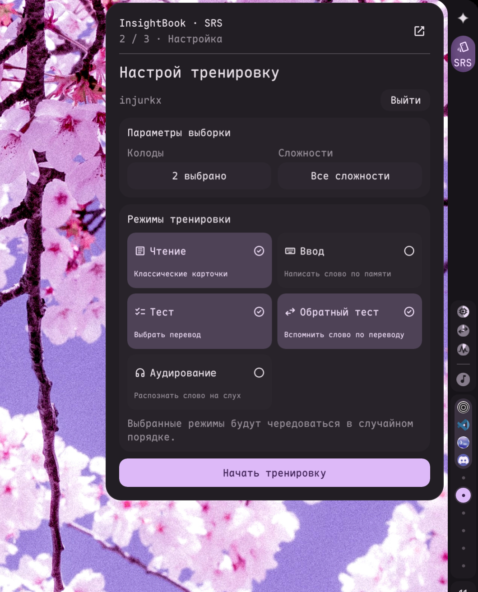
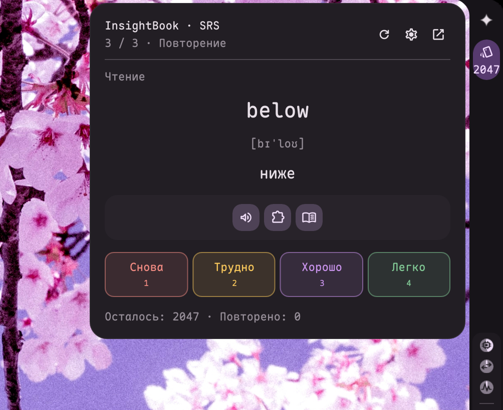

# quickshell-bar

Интеграция InsightBook SRS в панель end-4 / Quickshell `ii`.




## Установка

```sh
python3 tools/quickshell-bar/install.py
```

Нужны Quickshell с QtMultimedia, Python 3 и `xdg-open` для Яндекса. Дополнительных Python-пакетов нет. Кнопка находится сверху вертикальной панели, под значком end-4; в горизонтальной — рядом с треем. Установщик обновляет только добавленные компоненты и блоки кнопки, сохраняя резервные копии панелей в `~/.config/quickshell/ii/scripts/quickshellBar/backups/`.

Для другого пути: `python3 tools/quickshell-bar/install.py --shell /path/to/ii`. Повторный запуск не дублирует кнопку. После обновления end-4, перезаписавшего панель, запусти установщик снова.

## Три этапа

1. **Сервер и вход.** Укажи URL API, нажми «Далее», затем войди по логину/email и паролю либо через Яндекс в браузере. HTTP разрешён только для localhost, удалённые серверы требуют HTTPS. В режиме сервера `single` вход не требуется.
2. **Настройка тренировки.** Выбери одну или несколько колод, сложностей и режимов. Язык определяется колодами, перевод — русский. Кнопка «Начать тренировку» открывает карточки. Имя аккаунта и кнопка «Выйти» находятся здесь.
3. **Повторение.** Пройди карточку и оцени, насколько хорошо помнишь слово. Срок следующего повторения рассчитывает FSRS на сервере. Шестерёнка возвращает к настройке.

Режимы: чтение, ввод слова по переводу, выбор перевода, выбор слова по переводу, аудирование с выбором перевода. При выборе нескольких режимов они чередуются случайно. Варианты ответов берутся из словаря того же языка; если разных ответов меньше двух, используется карточка для чтения. Озвучка запрашивается через существующий `/api/tts` при нажатии «Послушать слово» и использует настройки TTS сервера.

После раскрытия ответа доступна панель озвучки, грамматики, лексики и заметок; кнопки заметок появляются только при наличии данных. Показывается исходное предложение, если оно сохранено со словом. Оценки выделены красным, жёлтым, фиолетовым и зелёным.

Пробел раскрывает карточку чтения, 1–4 выбирают ответ в тесте, а после раскрытия — оценку. Enter проверяет введённое слово. Esc закрывает popover. Кнопка «Открыть отдельным окном» в заголовке отделяет SRS от бара; та же кнопка возвращает его обратно. Карточка, раскрытый ответ и настройки при переключении сохраняются. Отдельное окно можно двигать за заголовок и изменять его размер; двойной щелчок по заголовку разворачивает окно. Клик снаружи его не закрывает. До запуска очередь не загружается, кнопка показывает `SRS`. Число оставшихся слов появляется только после запуска. Фоновое обновление очереди работает раз в минуту после запуска, когда popover закрыт. Основной popover не прокручивается; длинные списки выбора открываются отдельно. POST оценок автоматически повторяется только после ответа 401 и успешного обновления авторизации; сетевые ошибки записи требуют обновить очередь.

## Сессии

Приватные настройки находятся в `$XDG_CONFIG_HOME/quickshell-bar/settings.json`, обычно `~/.config/quickshell-bar/settings.json`: каталог `0700`, файл `0600`. Пароль не сохраняется и не попадает в аргументы процесса. Токены не выводятся в UI, IPC или логи. При смене сервера сессия сбрасывается. Ранее сохранённая сессия `insight-book-bar` переносится автоматически.

Новые маршруты бека:

- `POST /api/auth/session/login` — `{ login, password }` → `{ accessToken, refreshToken, expiresIn, user }`.
- `POST /api/auth/session/register` — регистрация с выдачей пары.
- `POST /api/auth/session/upgrade` — обмен ещё действующего старого JWT на пару.
- `POST /api/auth/session/refresh` — `{ refreshToken }` → новая пара токенов.
- `POST /api/auth/session/logout` — `{ refreshToken }` → отзыв refresh token.
- Вход через Яндекс с `session=desktop` и `session_id` возвращает пару через `/api/auth/status`.

Access token действует 15 минут. Refresh token хранится на сервере только в виде SHA-256 хеша, действует 90 дней после последнего обновления и заменяется при каждом обновлении. Повторное использование старого refresh token отклоняется. После выхода новые access token получить нельзя; уже выданный access token истекает в пределах 15 минут.

Помощник обновляет токены перед истечением access token и после 401, под межпроцессной блокировкой, сразу сохраняя новую пару. Пароль для продления не используется. Отозванная или истёкшая refresh-сессия возвращает к входу.

Для новых маршрутов требуется публикация бека с миграцией `0038_needy_hulk.sql`. До публикации вход по паролю совместим с существующим `/api/auth/login`, а Яндекс — с прежним токеном. Такая старая сессия не поддерживает автоматическое продление; после публикации новых маршрутов нужно выйти и войти заново.

Счётчик использует `/api/dictionary/review/count`. До публикации этого маршрута при 404 считает подходящие слова через полный словарь. Фильтры нескольких колод и сложностей применяются и к очереди, и к счётчику. На старом беке очередь тоже формируется из полного словаря, чтобы лимит первой страницы не скрывал выбранные слова.

## Проверка и удаление

```sh
python3 -m unittest discover -s tools/quickshell-bar -p 'test_*.py' -v
bun test apps/server/src/services/auth-session.service.test.ts apps/server/src/repositories/dictionary.repository.test.ts apps/server/src/controllers/dictionary.controller.test.ts
qs -c ii ipc call quickshellBar status
qs -c ii ipc call quickshellBar open DP-1
python3 tools/quickshell-bar/install.py --remove
```

Тесты используют временные данные. Удаление убирает только импорты и блоки кнопки из обеих панелей; настройки и резервные копии сохраняются. Чтобы удалить токены и отозвать серверную refresh-сессию, сначала нажми «Выйти» в виджете.
